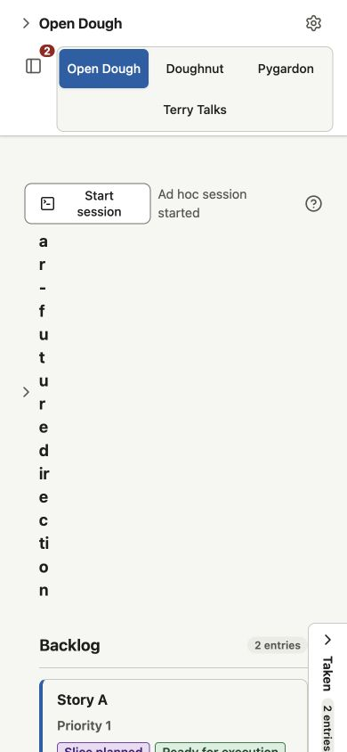
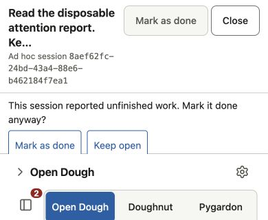
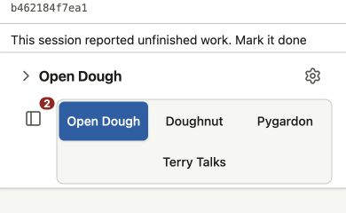

# Mobile dashboard manual-testing report — 2026-10-13

One hour of manual observation of the completed “Use the dashboard from an
iPad or iPhone browser without compromising desktop operation” story
(`SEED-133#operate-dashboard-from-mobile-browser`). Two discrepancies were
confirmed and queued as separate stories in
[SEED-135](../../../../.planning/seeds/SEED-135-mobile-dashboard-observed-discrepancies.md).
This report preserves that observation; it is not an automated regression test.

## Conditions and budget

- Product revision: `5ba1e47cf39e4b93218923bc01413259c7dd860a`.
- Testing checkout revision: `e28e94fa02193b28f3dcd6f9ae998aa19562a8d2`.
- Browser: Google Chrome 155.0.8059.40, with phone/tablet touch and viewport
  controls and desktop mouse/keyboard interaction.
- Setup: real local dashboard builds; existing disposable GitHub, repository,
  and Claude fixtures. Browser terminal traffic used the fixture's native
  session through the real terminal/WebSocket/PTY path.
- Began at 2026-10-13 01:42:36 UTC; ended at 05:20:20 UTC. A browser-control
  stall of 9,463.7345 seconds was excluded, leaving 3,600.2655 seconds against
  the requested 3,600 seconds. Expired fixtures were restarted at the same URLs
  after the stall; those expiry failures were environmental observations.

The oracle was the SEED-133 story recovered at `2b88b055`, its later accepted
scope decisions, and current dashboard documentation. This is local Chromium
observation, not proof on physical iPads/iPhones or Safari. Physical iOS
keyboard behavior and remote/Tailscale connectivity were outside that accepted
scope. Native host behavior used synthetic fixtures rather than paid real
Claude, Codex, or Cursor sessions.

## Coverage observed

- Phone/tablet portrait and landscape reading, long story titles and source
  paths, direction disclosure, dependencies, readiness, and work stages.
- Story inspection and a large review with 63 files, 201 diff lines, and wide
  lines; retained context and touch reading.
- Launch drafts through orientation changes, host selection and cancellation,
  refusal, uncertainty, and Continue recovery.
- Terminal typing at reduced visible height, traffic, resizing, close/reopen,
  and retained session identity.
- Session attention and read actions, details, Keep open, and retained final
  reports after their clean saved workspaces were removed.
- Settings project add/remove, key and theme interactions, failed writes, and
  retry; corresponding desktop navigation, shortcuts, focus, simultaneous
  context, resizing, and reduced motion.

## Confirmed discrepancies

### M1 — Direction disclosure becomes unreadable after Start session

**Expected:** Near-future direction stays readable and compact alongside
reachable project actions and the successful launch answer.

**Actual:** At 390×844 and 430×932, the collapsed heading measures 13.27 pixels
wide and 469.69 pixels tall after “Ad hoc session started” appears. It wraps
almost letter by letter and pushes the work stages down. At 768×1024 it measures
180.06×26.09 pixels. Reloading clears the transient answer and restores layout.

1. Use a phone touch view at 390×844.
2. Start an isolated ad hoc Claude session with a typed instruction.
3. Close its automatically opened terminal.
4. Read the project action row while “Ad hoc session started” remains visible.

[Captured DOM](phone-ad-hoc-direction-collapse-dom.txt).
[Queued repair](../../../../.planning/seeds/SEED-135-mobile-dashboard-observed-discrepancies.md#read-direction-after-phone-session-start).

### M2 — Short final-report panel hides Done confirmation choices

**Expected:** Mark as done and Keep open remain available by touch when
confirming unfinished work in a reduced-height final-report panel.

**Actual:** At 390×320, Keep open ends at y233.66 while its panel ends at y224,
clipping its lower portion. At 390×240 both choices are hidden. Touch scrolling
moves the panel without exposing them; the intended Keep open location hits the
dashboard source-evidence disclosure beneath it. Restoring 390×844 exposes the
choices. Desktop 1440×900 exposes both; keyboard dismissal works.

1. Start an isolated disposable session and submit an unfinished report.
2. Remove only its clean saved workspace and reload.
3. Open Read final report and reduce the visible viewport to 390×320 or 390×240.
4. Tap Mark as done, then use ordinary touch scrolling to try to reach Keep open.

[Queued repair](../../../../.planning/seeds/SEED-135-mobile-dashboard-observed-discrepancies.md#reach-final-report-done-choices-on-short-phone).

## Separate improvement

The historical “Launch uncertain” answer remains alongside a confirmed Working
session after Continue succeeds. Current documentation explicitly preserves
older failed/uncertain answers, so this was recorded as a possible messaging
improvement rather than a failed acceptance. It is not one of the two queued
discrepancies.

The [original observation data](findings.json) retains the measurements and
mission recovery references. Temporary setup specs, builds, fixtures, and the
testing worktree were removed when that mission closed. No product repair or
permanent automated test was made during the observation.
