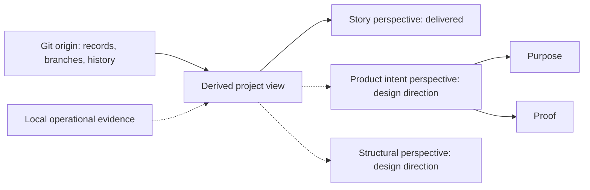

# 0008 — Project dashboard domain and architecture

**Status:** Accepted

**Accepted:** 2026-10-27, by Terry Yin, including the dashboard UI concepts below.

**Date:** 2026-09-19

**Decision makers:** Terry Yin

**Consulted:** Terry Yin supplied the dashboard requirements and directed the
UI concept definitions and acceptance on 2026-10-27.

## Context

Continuous trunk integration makes project progress harder to understand through
story branches alone. Unfinished stories can already have increments integrated,
while multiple developers progress different work. A graphical view should help
developers understand the project's work and progress.

The [project visibility requirements](../project-visibility-requirements.md)
retain the detailed behavior, examples, and exploratory ideas. This decision
records the stable domain distinctions and architectural intentions. It
does not select an implementation or authorize execution.

The living [Dashboard UX/UI North Star](../dashboard-ux-ui-north-star.md)
provides temporary interface direction and review criteria. Update it through
actual use without treating its design hypotheses as accepted architecture.
The [dashboard technology recommendation](../dashboard-tech-stack.md) separately
proposes a strongly typed stack; its tool choices are not accepted by this ADR.

## Decision

### Domain concepts and relationships

| Concept | Intended meaning |
| --- | --- |
| Project | The product and development work being observed, with its repository as the durable home of workflow records. |
| Story | An intended change or possibility pursued for user or learning value. It may cross existing product and code boundaries, and can exist outside the backlog. |
| Product backlog | The selected, ordered work for the project. Membership is a workflow fact about a story, not the definition of a story. |
| Taken story | Work claimed for execution, with a recorded developer assignment. Taken does not prove that an agent is currently running. |
| Developer identity | A reusable name, distinct from a story, assignment, or AI session. |
| Developer assignment | An undertaking to prepare or execute identified work. Its profile records the current developer, activity, and available tool/model information. |
| Launch workflow | What a dashboard launch starts on one work item, such as execution or refinement: the skill it runs. A launch is local evidence and never settles or moves a story. |
| Execution mode | The workflow by which a story is executed and integrated. Story Branch Mode and Trunk Mode have different publication locations. |
| Slice plan and slice | A plan organizes bounded executable slices of a selected story. Recorded slice completion supplies progress evidence; a plan is not mandatory for every story. |
| Product intent | The maintained definition of intended behavior: what the current product is meant to do and why. It evolves with the product and survives individual stories. Each Product intent contains Purpose and Proof. |
| Structure | The logical organization of the product's implementation, expressed through its domain model and mapped to packages, folders, files, and functions. |
| Local workspace | An owned checkout in which a developer prepares changes and publishes to an authorized remote destination. Several worktrees can share one local repository. |
| Optional default checkout | A developer's checkout that may be refreshed after remote trunk publication. Its presence, edits, and freshness are local operational facts, not workflow authority. |

Stories describe attempts to change the product; product intents and structure
describe the product that survives those stories. Story, Product intent, and
Structure are independent related dimensions whose relationships can be
many-to-many: a story can change several product intents and structural
elements, and a product intent can endure through many stories and span several
structural elements. Mapping and filtering remain design possibilities.

Product intents describe the current product and evolve with intentional
changes. A regression supplies evidence against fulfillment while the product
intent remains the expectation to evaluate. Completing and removing planning
records must leave lasting product knowledge in its maintained home, following
[ADR 0000](./0000-use-adrs-accepted.md). Future possibilities stay in planning.

[ADR 0001](./0001-ubiquitous-language-accepted.md#dashboard-product-concepts)
records the shared vocabulary. Each Product intent contains **Purpose**, the
expected behavior and why it matters, and **Proof**, executable verification
and supporting evidence. Proof distinguishes maintained procedures from
particular observed results.

Storage, proof representation, and presentation remain design choices.
Detailed semantics, evidence considerations, and open questions belong in the
[requirements](../project-visibility-requirements.md#product-intent-perspective-the-current-product).

Derive Preparing from an active preparation assignment; keep refinement,
planning, and readiness as independent story facts. One AI session may carry
successive assignments. [ADR 0007](./0007-software-development-lifecycles.md#shared-work-assignments)
proposes assignment lifecycle and recovery; neither an assignment nor its age
proves that an agent is running or has stopped.

Present the story state defined by [ADR 0002](./0002-software-development-lifecycle-principles-accepted.md)
without implying live activity. Distinguish missing, outdated, and conflicting
evidence from an explicit negative result.

### Dashboard UI concepts

| Concept | Meaning |
| --- | --- |
| Board | The selected project's work overview, containing the Backlog, Taken, and Recently done columns. |
| Column | One named region of the Board, grouping work by recorded story membership or session disposition. |
| Story card | A representation of one story within a Column, holding its facts, actions, and associated Session entries. |
| Session entry | A representation of one agent session, within a Story card, directly in a Column, or in the Sessions sidebar. |
| Sessions sidebar | The left-hand region listing open agent sessions across projects, with an optional Running Cursor sessions section. |
| Side panel | The auxiliary region, normally to the Board's right, showing one terminal, final report, or story review at a time. |
| Panel divider | The resize control between the Board and Side panel when they appear side by side. |
| Scrollbar | A control that scrolls its owning region; qualify it by that region, such as Board scrollbar or Side panel scrollbar. |

Use these names directly across UI language, architecture, code, tests, and
documentation, adapting casing only to programming syntax. Each concept has
one name and responsibility; keep no competing synonym or alias layer. A Panel
divider resizes; a Scrollbar scrolls. Terminals, final reports, and story reviews
are Side panel contents, not names for the shared region. Layout and scrolling
mechanics remain in the [navigation guidance](../dashboard-navigation.md).

### Durable project state and local operational state

The project's repository owns durable workflow records. The dashboard reads
those records to construct its view; it is not an independent authority for
backlog membership, developer assignments, or progress. Any derived cache or
display model must be rebuildable from its sources rather than becoming the
only home of project state. Completing work leaves a short published done
record beside the backlog, which the dashboard reads like any other record.

Project configuration is machine-local operational state, separate from the
observed repositories' workflow records. There is no application/server
database; optional browser storage is disposable.

Published progress comes from Git state on origin, including relevant branch
contents and history. A reader must not need a developer's clone, unpushed
commits, agent conversation, or temporary runtime files to show published
progress. Fetching or caching remote Git data is compatible with this boundary.

For Taken work, the durable record identifies the assigned developer and
execution mode. Story Branch Mode also identifies its execution branch on
origin so the reader can locate published progress. Trunk Mode needs no remote
story-branch field. Local branch and worktree locations belong to the local
operational view rather than required remote backlog metadata.

Machine-local session evidence supplements the published view without owning
its workflow facts. Owned-workspace activity and optional default-checkout
refresh outcomes remain separate local operational concerns. Missing observation
means local activity is unknown; an observed absence of a default checkout is a normal
condition, not blocked work. Published progress remains visible independently
of that local evidence.

These are logical responsibilities and information flows, not prescribed
services, processes, deployment units, or storage technologies.

### Spatial presentation remains derived

The Board presents connected Columns with zoom, focus, and animation, as
detailed in the requirements and UX/UI North Star. A Column
groups supported workflow facts; drawing a connector does not establish a new
persisted state, a dependency between stories, or a mandatory linear lifecycle.
Story identity and source evidence remain stable independently of card placement.

Viewport position, zoom, focused work, and animation are presentation state,
separate from published project facts and machine-local operational evidence.
Losing them loses no project progress. Motion can explain a change between
observed snapshots; it cannot establish unobserved activity. This
intention does not prescribe canvas, a graph library, or stored layout data.
Build these interactions just in time for the selected story's reading goal;
the visual direction does not justify advance navigation infrastructure.

### Observe workflow outcomes without owning them

Keep record maintenance, remote integration, and local workspace management in
the workflow. Let the dashboard observe their evidence without requiring a GUI
for agent cooperation.

[ADR 0009](./0009-git-branching-and-integration.md) proposes branching and
integration direction and remains Proposed.
Owned workspaces publish to remote destinations; remote trunk is the shared
integration authority. The dashboard observes accepted remote revisions for
published progress and uses machine-local evidence for checkout activity.

Fresh preparation and execution use fetched remote history in an owned workspace
under the applicable workflow procedure, including the
[preparation workspace procedure](../../src/skills/dough-story-refinement/references/preparation-workspace.md).
They do not depend on a default checkout. Land and wrap-up share the remote
publication and recovery contract across worktrees and machines; a dashboard
must not infer successful integration merely from a local branch advancing.

After remote trunk accepts work, optional local refresh may advance a clean
checkout on the expected branch. Deferred or failed refresh preserves local
work and remains visible separately from successful remote publication. A
missing default checkout requires no ownership or handoff state and does not
prevent owned-workspace retirement. Explicit developer checkout edits use their
existing task authority; this model requires no automated checkout coordination
protocol.

Use the [requirements](../project-visibility-requirements.md) for local-edit,
freshness, and recovery examples. Recheck observable checkout state around
local mutations and preserve changes from human developers and other tools.
Terry's 2026-09-28 direction replaces this record's earlier default-checkout
ownership and coordination proposal.

### Incremental scope

The implemented dashboard provides the story planning and execution perspective,
including local-session capabilities. Published progress remains independently
readable from Git; local observations add information about this machine without
becoming the authority for project state. The
[dashboard guide](../../dashboard/README.md) and
[agent launch contract](../../dashboard/AGENT-LAUNCH.md) own current capabilities.

The product intent and structural perspectives remain design direction.
Their meaning constrains how we understand the product without requiring their
machinery in advance. Their UX/UI, proof information, and architectural North
Star placement remain open. Presentation and storage choices belong to that
design work; current story-dashboard capabilities follow their delivered
contracts.

## Consequences

- The dashboard can be replaced or rebuilt without losing authoritative project
  progress, and the first useful view does not depend on local monitoring.
- Remote visibility is limited to published evidence. Taken work and an old
  update cannot establish that an agent is currently running or has stopped.
- New perspectives require sufficient evidence for their claims. A maintained
  product intent inventory and Proof model need their own design and
  implementation work.
- Story identity, developer assignment, execution mode, and workspace ownership
  remain distinguishable, avoiding accidental coupling to a temporary branch,
  recycled name, or default checkout.
- Local evidence can explain workspace activity and deferred refresh, but
  cannot establish unobserved activity or imply that a default checkout is
  required for remote work.

## Open design and related decisions

Purpose and Proof representation within Product intent, cross-perspective
relationships and UX/UI, architectural North Star placement, and possible
assignment messaging and takeover remain open in the
[requirements](../project-visibility-requirements.md#questions-retained-for-later-design).
This direction selects no new GUI framework, daemon, database, schema, or
distributed scheduler.

This decision builds on
[ADR 0001 — Ubiquitous language](./0001-ubiquitous-language-accepted.md),
particularly its story and slice concepts, and
[ADR 0002 — Software development lifecycle principles](./0002-software-development-lifecycle-principles-accepted.md),
particularly whole-product understanding, continuous integration, direct domain
mapping, and incremental learning. No exception to either is proposed.

Treat [ADR 0007](./0007-software-development-lifecycles.md) as a proposal;
follow ADR 0002 while its delayed-integration conflict remains unresolved.
Leave acceptance, supersession, and exceptions to humans under the
[ADR advice process](./README.md).
