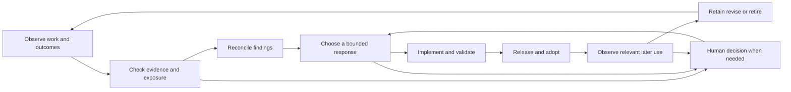

# Empirical process control for Open Dough

Research report for Terry Yin, 17 October 2026.

Open Dough has much of the machinery for learning from experience: evidence-based reviews, stable finding identities, response tracking, release provenance, and a watch for recurrence. Its largest opportunity is to connect these into a dependable loop that establishes **whether a change improved useful outcomes under relevant conditions, including its later costs**. Increasing the number of retrospectives alone would not establish that.

The recommended direction is to close one existing response loop first, add proportionate observation across the lifecycle, and then automate the proven decisions within explicit authority. Token consumption belongs in this evaluation as a resource cost. Product usefulness, correctness, changeability, and human attention determine whether spending fewer tokens constitutes an improvement.

This report separates established research from proposed applications. The internal assessment describes guidance and records at commit `13b57efb4f65f5af1b0bf06568f6c2cd2fce01a2`, with source `VERSION` 0.3.63. It does not establish how consistently agents follow that guidance in practice. External research covers industrial quality control, experimentation, software process improvement, software quality, and human oversight; it is a targeted research synthesis, not an exhaustive systematic literature review.

## What empirical process control means

There is no reason to adopt an Agile methodology to obtain an empirical feedback loop. Scrum's transparency, inspection, and adaptation provide a concise description of its own approach, but that description does not supply a measurement theory, a causal evaluation method, or an industrial control design. The relevant foundations come from several related disciplines. [Scrum Guide, 2020](https://scrumguides.org/docs/scrumguide/v2020/2020-Scrum-Guide-US.pdf).

The terminology also varies by field. An industrial article titled *Empirical Process Control* concerns tuning live PID controllers. That is different from organizational inspection and adaptation, although both use observations to influence action. [Reed, Chemical Engineering Progress, 2021](https://publications.aiche.org/cep/2021/december/empirical-process-control-part-2).

| Foundation | What it contributes | What it does not establish by itself |
| --- | --- | --- |
| Statistical process control | Distinguishing stable variation from evidence that the generating process changed | Whether the process delivers something customers value, or what caused a signal |
| Scientific experimentation and PDSA | Predictions, deliberate interventions, comparison with observations, and revision of explanations | That any particular ceremony or improvement method works everywhere |
| Feedback control engineering | Attention to sensors, interventions, disturbances, delay, and stability | A validated mathematical model of software development |
| Software process improvement | Goal-linked measurement and learning within and across projects | A universally optimal development process |
| Jidoka and human factors | Detecting abnormalities, containing harm, and making consequential exceptions intelligible to people | That transferring the hardest cases to a human automatically produces effective oversight |

A useful working definition for Open Dough is: **observe work and its outcomes, compare them with explicit intentions and predictions, make bounded changes, and use subsequent evidence to decide whether to retain, revise, or abandon those changes.** This is a synthesis for this project, rather than a quotation or a new universal standard.

Three distinctions matter:

1. **Control and improvement differ.** Containing a known defect or restoring a violated contract is an operational action. Changing the process to improve its future performance is a learning intervention. Both need evidence, but they need different decision rules.
2. **Statistical stability and adequacy differ.** A process can be predictable and consistently poor. Conversely, a useful new approach may initially lack enough observations for a stable statistical characterization. Acceptance requirements come from intended outcomes; control limits come from observed variation. They are not interchangeable. [NIST, process stability](https://www.itl.nist.gov/div898/handbook/ppc/section4/ppc45.htm).
3. **Description and causal explanation differ.** A transcript can establish that an agent reread a file six times. It does not alone establish that a specific instruction caused the rereading, or that removing that instruction will preserve quality.

## Principles to carry into Open Dough

### Define improvement before choosing measurements

The governing goals already exist in [ADR 0002](../adrs/0002-software-development-lifecycle-principles-accepted.md#optimization-goals): deliver the highest user value first and retain the ability to change direction at extremely low cost. Its principles also recognize future judgment burden, whole-product coherence, and the cost of maintaining guidance. The missing piece is an operational account of how a particular intervention advances those goals.

For each improvement, state the beneficiary, the observed problem, the expected change, and the conditions that would make the change unacceptable. For example: “Reduce unnecessary context recovery during continued execution, while preserving required checks after an actual interruption or changed repository state.” That is evaluable; “make the agent more efficient” is not yet evaluable.

### Study predictions rather than merely collecting impressions

Deming's PDSA cycle explicitly starts with a goal, a theory or prediction, success measures, and a plan. Study compares what happened with that prediction; the next action follows the learning. A retrospective can generate the hypothesis, but a persuasive retrospective narrative does not complete this cycle. [Deming Institute, PDSA](https://deming.org/explore/pdsa/).

For Open Dough, each substantive process response should have a concise prediction and a later observation decision. Preserve “inconclusive” as a legitimate result. A merged change, a completed story, or an absence of complaints is a different fact from an improvement demonstrated in use.

### Distinguish ordinary variation from a changed mechanism

A single difficult run can arise from task difficulty, transient infrastructure, incomplete context, stochastic model behavior, or a deficient process. Rewriting general instructions after every costly run risks introducing instability and additional rules. Investigate the mechanism and compare relevant cases before generalizing.

This does not mean waiting for statistical significance before correcting a demonstrated defect. Contain the defect immediately when necessary; keep the broader causal claim proportionate to the evidence. “Special cause” does not mean merely “rare,” and “common cause” does not mean merely “reported often.” These describe the source of variation within the defined process. NIST treats chart signals as grounds for investigation; Deming's funnel experiment illustrates how unnecessary adjustment can increase variation. [NIST, control charts](https://www.itl.nist.gov/div898/handbook/pmc/section3/pmc31.htm), [Deming Institute, funnel experiment](https://deming.org/explore/the-funnel-experiment/).

Persistently inadequate performance generated by the ordinary system calls for changing that system. Repeatedly treating its individual outputs as exceptional failures will not address the mechanism. For Open Dough, a missing check in shared guidance and a transient tool outage can both require immediate correction, while suggesting different longer-term responses.

### Make the observation system trustworthy

Measurement itself has repeatability, reproducibility, bias, and stability problems. In agent workflows, missing sub-agent traces, changed log formats, token estimates, inconsistent start boundaries, and different evaluators can all create apparent improvement. [NIST, Measurement Process Characterization](https://www.nist.gov/publications/nistsematech-engineering-statistics-handbook-chapter-2-measurement-process).

Record whether an observation is direct, inferred, unavailable, or not applicable. Separate “review ran and found nothing” from “review did not run.” Validate extractors against known traces before trusting a trend. A change to telemetry or a metric definition needs to be visible in comparisons; otherwise the instrument may explain the result. [Microsoft, post-experiment trustworthiness](https://www.microsoft.com/en-us/research/articles/patterns-of-trustworthy-experimentation-post-experiment-stage/).

### Compare comparable work and account for changes in context

Task mix, model, tool host, installed guidance, repository state, concurrency, and available context affect the outcome. Aggregate tokens per story can fall simply because the next stories are easier. A lower finding count can mean less observation.

Use narrowly defined case families and retain relevant context. For low-volume heterogeneous work, linked cases, timelines, and explicit mechanisms can be more informative than a control chart. Use statistical process control only where the measurement definition, sampling, and process assumptions support it. Neither a control chart nor a large volume of logs manufactures comparability. Blocking and replication offer established ways to handle known nuisance factors and estimate variability in designed comparisons. [NIST, randomized block designs](https://www.itl.nist.gov/div898/handbook/pri/section3/pri332.htm).

### Separate causal experiments from observational monitoring

Monitoring reveals where to investigate. An experiment makes a deliberate contrast that can help identify the effect of an intervention. Before a comparison, specify the hypothesis, outcome measures, guardrails, and unit being compared. Shared infrastructure or shared agent context can contaminate a contrast. [Microsoft, pre-experiment trustworthiness](https://www.microsoft.com/en-us/research/articles/patterns-of-trustworthy-experimentation-pre-experiment-stage/).

For an agent rule, a useful initial experiment may run the old and proposed guidance on matched repository snapshots in isolated sessions, with repeated trials where model randomness matters. Evaluate the resulting behavior independently. This establishes evidence for those scenarios; it is not automatically evidence of long-term benefit in every project.

When randomization is impractical, use the strongest feasible alternative: matched cases, a staged rollout with a comparison group, or a time series annotated with interventions and confounders. Describe before-and-after evidence as observational when it cannot isolate the cause. Do not turn five related sub-agent actions into five independent replications.

### Include later effects and whole-system costs

Short-term indicators can move in the desired direction while long-term value deteriorates. Industrial software experiments document selection, survivorship, and measurement problems even in long-running tests; simply waiting longer does not remove bias. [Dmitriev et al., 2016](https://www.microsoft.com/en-us/research/publication/pitfalls-of-long-term-online-controlled-experiments/).

Open Dough should therefore evaluate the next relevant use or modification as well as initial delivery. Saving tokens by omitting investigation may increase escaped defects or future reconstruction. Increasing successful runs by handing more work to humans may conceal a transfer of cost. Faster implementation can coexist with slower delivery if review, CI, or integration becomes the bottleneck.

### Close the loop through actual exposure

The causal path is longer than “finding → fix”: a response must be implemented, released when appropriate, installed or otherwise applied, exercised under the relevant conditions, and observed. No recurrence without an opportunity for recurrence is weak evidence.

Preserve the distinction between administrative closure and empirical confidence. It can be sensible to retire an old finding from an active file while retaining only limited confidence in the fix. Open Dough's existing watch procedure already makes this distinction; it should remain explicit as automation expands.

### Make human intervention informed and selective

Toyota's account of jidoka connects abnormality detection with stopping defective work and reducing the need for continuous human watching. It also emphasizes understanding the work and its abnormalities before automating it. This supports defining meaningful stop conditions before connecting a collection pipeline to autonomous actions. [Toyota Production System](https://global.toyota/en/company/vision-and-philosophy/production-system/).

Automation can leave the human with difficult abnormal cases and insufficient context. This problem was identified in industrial automation well before current AI agents. [Bainbridge, 1983](https://www.sciencedirect.com/science/article/pii/0005109883900468).

For Open Dough, a stop should explain the triggering evidence, the affected scope, what remains safe to continue, plausible options, and the decision needed. Human attention belongs where it changes the outcome: disputed intent, conflicting values, architectural authority, uncertain high-impact action, or authority outside the existing delegation. Routine reversible actions within established authority need not repeatedly interrupt the human.

### Evaluate the improvement mechanism itself

A review, rule, or monitor consumes resources and can introduce false alarms or delay. Measure whether it changes useful decisions, how much effort it costs, and what it misses. Prefer simplifying or removing a mechanism when its demonstrated benefit no longer justifies its burden. This follows ADR 0002's existing principle; it does not require a new compulsory measurement platform.

## What software research adds

### Goal linked learning within and across projects

Basili's Goal/Question/Metric approach starts with goals, derives the questions needed to assess them, and then selects measurements. His Quality Improvement Paradigm characterizes the project and environment, sets goals, chooses a process, executes while collecting and validating data, analyzes results, and packages reusable learning. His work distinguishes feedback within a project from learning across projects. [Basili, QIP](https://www.cs.umd.edu/users/basili/qip/tsld006.htm), [Basili, Process Improvements for Software Quality and Reliability, 2000](https://www.cs.umd.edu/~basili/presentations/processimprovements.boston.pdf).

This is especially relevant because Open Dough operates at two levels. A project uses guidance to deliver its product; Open Dough learns across those uses to improve the guidance, which is itself a product. A project-specific adaptation should not automatically become a universal rule. Retained learning needs the conditions under which it worked and the conditions that remain uncertain.

The SEI's industrial software measurement guide similarly focuses on enduring organizational performance beyond the immediate project. It is a methodological bridge from industrial process management to software, rather than evidence that one fixed metric set improves every organization. [Florac, Park and Carleton, 1997](https://sei.cmu.edu/library/practical-software-measurement-measuring-for-process-management-and-improvement/).

### Limits of transferring manufacturing methods

Software development repeatedly changes the thing being built and often the process used to build it. Paulk's application of SPC to the Personal Software Process stresses comparable data, application-domain differences, and the possibility that old-process data no longer fit a changed process. It also recognizes that control charts are not necessary or economical for every software process. [Paulk, 2000](https://personal.utdallas.edu/~mcp130030/papers/p2000j.pdf).

A later systematic mapping of software SPC found that operational definitions were often missing and defect measures dominated the literature. Its accompanying practitioner evidence was small and explicitly limited in generalizability. The lesson is to define how a measure is collected and used before treating its name as an instrument. [Brito, Barcellos and Santos, 2018](https://link.springer.com/article/10.1186/s40411-018-0054-4).

For Open Dough, a metric specification should identify the entity and unit, start and end boundaries, inclusion/exclusion rules, missing-data treatment, and intended decision. “Lead time,” for example, is ambiguous until it says whether time starts at initial idea, accepted mission, execution, or commit, and whether it ends at delivery, installation, or successful use.

### Balanced software outcomes

SPACE rejects a single metric or dimension as a complete account of developer productivity. DevEx adds a useful emphasis on feedback delay, cognitive load, and flow, and on comparing workflow observations with human experience. These are organizing frameworks, not universal numerical productivity formulas. Their relevant implication here is to measure useful performance and human burden alongside activity and resource use. [Forsgren et al., SPACE, 2021](https://www.microsoft.com/en-us/research/publication/the-space-of-developer-productivity-theres-more-to-it-than-you-think/), [Noda et al., DevEx, 2023](https://www.michaelagreiler.com/wp-content/uploads/2024/06/DevEx-WhatDrivesProductivity.pdf).

DORA provides useful delivery measures balancing throughput and instability, with explicit cautions about unlike applications and metric gaming. Its 2024 survey analysis is not a randomized or longitudinal causal test. Borrow its balance and measurement discipline; do not import performance bands as Open Dough's targets or infer that delivery speed measures product value. [DORA metrics guide](https://dora.dev/guides/dora-metrics/), [DORA 2024 report](https://dora.dev/research/2024/dora-report/2024-dora-accelerate-state-of-devops-report.pdf).

### Product and architecture belong in the feedback

Product quality is an output through which a development process can be judged. Product opportunity discovery asks a related question: whether the intended outcome was valuable in the first place. Both matter. Refactoring can restore intended structure; it contributes to process learning when the intervention and its later effects test a specific explanation.

There is no justified universal ratio of “new complexity” to “new functionality” for Open Dough. A small implementation can hide considerable future interpretation work, while a larger coherent domain change can reduce it. SEI's Architecture Tradeoff Analysis Method offers a useful alternative: examine concrete quality scenarios and their tradeoffs, rather than assigning one architecture score. [SEI, ATAM](https://www.sei.cmu.edu/library/the-architecture-tradeoff-analysis-method/).

Proportionate scenarios for this repository might ask: when a project changes its planning directory, how many representations must change? When one host changes its notification interface, is the adaptation local? When an acceptance obligation crosses slices, does its meaning and ownership remain intact? These are proposed diagnostic questions. Subsequent real changes can test whether the anticipated changeability was achieved.

Testing has a similar measurement problem. Inozemtseva and Holmes found that the relationship between coverage and fault-detection effectiveness weakened after controlling for test-suite size in their Java study, using mutation as the effectiveness proxy. Coverage remains informative about execution; it does not establish a test's ability to recognize incorrect behavior. [Inozemtseva and Holmes, ICSE 2014](https://www.cs.ubc.ca/~rtholmes/papers/icse_2014_inozemtseva.pdf).

Longitudinal developer reports also associate technical debt with later wasted effort, including testing work. Such observational evidence supports watching downstream burden, without supplying an Open Dough cost estimate or a universal debt percentage. [Besker, Martini and Bosch, 2019](https://research.chalmers.se/en/publication/511450).

### Agent evaluation changes the measurement problem

Agent benchmark research argues for measuring cost and success jointly, comparing against simple baselines, protecting held-out evaluation cases, and making results reproducible. Its benchmark findings do not imply that planning or reflection is generally wasteful in repository work. [Kapoor et al., AI Agents That Matter, 2024](https://arxiv.org/html/2407.01502v1).

METR's February 2026 account of changing its developer-productivity experiment is instructive: participant and task selection, noncompletion, output changes, and concurrent agents complicated the interpretation of timing. The researchers explicitly caution that their later estimates are weak evidence. This is a concrete example of the observation method needing revision as work changes, rather than a timeless claim about whether AI speeds development. [METR, 2026](https://metr.org/blog/2026-02-24-uplift-update/).

Small experiments can still guide action, but uncertainty must remain visible. Report individual cases and practical effects; a failure to detect a difference does not establish equivalence. Replicating one scenario many times measures stochastic variation in that scenario, not generality across projects. Recent software-experiment research reinforces the limitations of small samples and effect estimation; it does not provide a universal minimum run count. [Kitchenham and Madeyski, 2024](https://link.springer.com/article/10.1007/s10664-024-10504-1).

## The current Open Dough feedback system

The repository uses **Open Dough** and **DearDough.md**. Several concerns in the request are already partly addressed in the current guidance, although the existence of instructions does not demonstrate consistent execution.

| Concern | Current evidence | Remaining opportunity |
| --- | --- | --- |
| Improvement has no clear definition | ADR 0002 defines user value and inexpensive change of direction, with future judgment burden and guidance cost | Translate these into intervention-specific questions, evidence, and decision criteria |
| Retrospective performs a final refactor | It reviews aggregate implementation and residue, and may plan corrections; it explicitly does not implement them | Keep assessment, corrective execution, and proof of benefit distinguishable |
| Architecture and test quality are outside review | The retrospective explicitly reviews whole-product responsibilities, architecture, and whole-suite coverage/cost | Give important claims observable evidence and assess subsequent changeability |
| Only planned execution is reviewed | The retrospective also supports completed planless and quick-to-planned execution | No systematic process review at preparation completion was found; coverage depends on available history |
| Wrap-up and landing are excluded | Both support `--process-retrospective` for their own run | These reviews require explicit invocation and cover the run so far, not all future consequences |
| Process review is automatic everywhere | Planned execution normally invokes retrospective; the process focus is separately opt-in. This repository enables it | Record actual review coverage; generic-project defaults can produce selection bias |
| Findings require manual collection and prioritization | Internal skills and a runbook already connect collection, reconciliation, pruning, response watches, and queueing when invoked | Invocation and decisions are not yet an autonomous, continuously evaluated service |
| Feedback has no response observation | The runbook has release/adoption-aware watches and recurrence handling | Make eligible exposure and measured effects systematic without equating silence with success |

These findings come from the [execution retrospective](../../src/skills/dough-execution-retrospective/SKILL.md), [review of a wrap-up or landing run](../../src/skills/dough-execution-retrospective/references/process-review-of-a-run.md), [execution completion](../../src/skills/dough-execute-plan/references/finish-or-stop.md), [project configuration](../../.planning/open-dough.json), and [maintainer runbook](retrospective-findings-runbook.md).

The current process review has good evidential boundaries. It requires real coordinator and relevant sub-agent history, distinguishes observation from inferred cost and cause, permits recorded token counts or qualified evidence of repeated work, and refuses to invent missing events. It also reviews the retrospective's own waste without recursively launching another retrospective. The limitation is that these are primarily qualitative findings from available histories, rather than a consistent population of observed runs.

Two specific selection effects matter. First, [execution completion](../../src/skills/dough-execute-plan/references/finish-or-stop.md) does not automatically retrospect wholly planless completions, incomplete work, cancellation, or human-judgment stops. Second, the retrospective explicitly makes no log change when there are no findings, and the [recording format](../../src/skills/dough-execution-retrospective/references/process-finding-recording.md) says rows count retained occurrences, not all-time recurrence. Bounded retention can remove entries. The current log therefore cannot supply a failure-rate denominator: no row can reflect success, no review, no relevant exposure, missing history, or later pruning.

Data is not entirely absent. Findings contain some actual token-output counts, host-reported usage, timings, and concrete rework. These measures have different scopes and cannot safely be added into a global efficiency estimate. More systematic measurement can begin with what is already directly observable.

The [test-optimization skill](../../src/skills/dough-test-optimization/SKILL.md#establish-the-baseline) already contains a particularly strong empirical protocol: record comparable execution conditions, form a hypothesis, try and measure, retain or undo the change, preserve meaningful coverage, and report uncertain comparisons honestly. Its loop is a good internal pattern to adapt for guidance experiments.

The maintainer runbook is more complete than a one-way feedback inbox. It deduplicates by project and execution identity, verifies which release contained a response, distinguishes old-release reports from post-fix recurrence, and starts its one-week watch from verified use. A week without relevant use is explicitly unexercised. Its retirement decision is explicitly operational, not proof that recurrence is impossible. These are useful foundations to preserve.

The internal [shared-feedback skill](../../.agents/skills/collect-client-feedback/SKILL.md) provides finite collection, cleanup, prioritization, and publication across projects. The [bounded ODF-139 assessment](findings/ODF-139.md#bounded-effectiveness-evaluation--structured-obligations-2026-10-20) retains the response-effectiveness result and the next required ordinary-use evidence.

## A useful definition of improvement

For Open Dough, a proposed operational definition is:

> An improvement increases the ability to deliver valuable, correct outcomes or to change direction, under comparable relevant conditions, without an unacceptable increase in total effort, risk, or future maintenance burden.

This preserves ADR 0002's direction while recognizing tradeoffs. It does not collapse all concerns into one score. Product value and the acceptable tradeoff between cost, quality, and future flexibility remain human-owned judgments.

### A small set of decision-oriented measures

Choose a subset for each intervention. The table is a menu, not a requirement to instrument every project in full.

| Question | Candidate evidence | Interpretation limit |
| --- | --- | --- |
| Did the intended beneficiary obtain a useful outcome? | Acceptance of explicit outcome examples; observed successful use; later adoption or abandonment | A passing test or completed story alone does not establish customer value |
| Did correctness survive delivery? | Independently checked acceptance results; escaped defects and severity; attributable rework | Normalize by relevant opportunities and observation windows; unobserved is not zero |
| Can we change the result cheaply? | Effort for the next relevant change; coordinated edits across conceptual boundaries; repeated rule changes; maintenance explanations | File count, lines of code, or dependency counts are diagnostic proxies, not quality verdicts |
| What did the outcome cost? | Human active time and interruptions; model usage and cost; tool/CI time; retries and recovery | Keep these dimensions separate unless a defensible valuation exists |
| Where is work waiting? | End-to-end elapsed time, active time, queue time, blocked time, work in progress | Agent speed does not establish delivery speed |
| Do tests give useful confidence efficiently? | Time to decisive feedback; known regression detection; sampled mutation testing; flakes; diagnostic and maintenance effort | Coverage percentage alone cannot establish fault detection or assertion quality |
| Does a process response work in use? | Occurrences per eligible exposure, burden introduced, relevant downstream outcomes | Calendar time or fewer reports alone does not show effectiveness |
| Is autonomy helping? | Successful completion within authority; avoidable interruptions; missed necessary stops; recovery cost | Maximizing unassisted completion can suppress useful Jidoka stops |
| Does the controller earn its cost? | Findings that changed a decision; duplicate/noise rate; time to disposition and observation; review and collection cost | Finding volume is not a success target |

An appropriate initial set might be outcome acceptance, attributable rework, end-to-end time, human effort, and model usage where directly available. Add a measure when a concrete decision needs it. Qualitative evidence remains necessary for usefulness, domain coherence, and disputed tradeoffs.

### How to use tokens responsibly

Token efficiency is a useful candidate for **resource efficiency**, especially for repeated comparable tasks. It is not an adequate definition of improvement.

Within a fixed evaluation set, one descriptive measure is total tokens across all attempts divided by independently accepted outcomes. Include failed attempts, retries, relevant delegation, review, recovery, and correction. Report acceptance rate alongside the ratio, and separate cost components when the host supplies them. If no outcome succeeds, report that fact; do not turn the ratio into a meaningful efficiency claim.

Do not compare this ratio across different task mixes or silently drop incomplete work. Report model and configuration, installed guidance revision, and whether usage is measured or estimated. Token types and monetary cost can differ across models and caching conditions, so retain both observed usage and actual cost when available. Never fabricate usage that the host does not expose.

For example, a shorter prompt that reduces initial tokens but causes more incorrect completions and later rework has not established improvement. A more expensive investigation that prevents repeated defects may be beneficial. Evaluate the total decision-relevant cost and the quality of the resulting work.

### Give long-term consequences an observable form

Use two linked observation windows: immediate acceptance and the next meaningful exposure to the consequences. A process rule can be checked during the next comparable workflow; an architectural change during the next change to the affected concept; a testing change against known failures and later regressions.

Record which later check remains pending. Do not demand a universal number of days or executions: the relevant delay depends on the mechanism. The existing seven-day watch can remain a bounded housekeeping policy, while evidence of effectiveness depends on actual exposure and the strength of the comparison.

## Observation across the lifecycle

Whole-lifecycle visibility does not require a full retrospective at every handoff. Small observations at existing boundaries can support focused analysis when a signal warrants it.

| Boundary | High-value observation | Decision it can inform |
| --- | --- | --- |
| Problem framing and decomposition | Intended beneficiary, unresolved assumptions, why work was selected, later invalidated assumptions | Whether the process is choosing useful work and learning cheaply |
| Story refinement | Material requirement changes, unresolved ambiguity, clarification and rework | Whether refinement reduces uncertainty that matters |
| Slice planning | Dependency assumptions, promised proof, later splits/replans, unsupported structural investment | Whether planning makes execution coherent at acceptable cost |
| Execution and refactoring | Outcomes, retries, observed defects, context recovery, changes to shared concepts, proof obtained | Whether execution practices prevent errors and support inexpensive change |
| CI and integration | Feedback delay, attributable failures, conflicts, recovery and repeated validation | Whether delivery is becoming the limiting step |
| Retrospective | Evidence coverage, supported findings, duplicates, hypotheses, analysis cost | Whether review creates useful information |
| Wrap-up and landing | Lost knowledge, recovery work, publication outcomes, follow-up ownership | Whether completion preserves value and continuity |
| Release and installation | Response-containing revision and actual adoption | Whether the proposed treatment reached the project |
| Later product use and maintenance | Recurrence, escaped defects, use, abandonment, next-change effort | Whether immediate gains survived real use |

Capture interruptions, abandoned attempts, and early failures as well as successful completions. A system that only observes completed plans can miss the most expensive failures. Distinguish a phase that did not occur from one that occurred without recoverable evidence.

A compact observation needs only what its decision requires: project and work identity; phase; relevant revision and environment; observation time or exposure; factual outcome; decisive evidence locator; and known coverage limits. Add tokens, timings, and classifications only where available and useful. Derive existing facts from their authoritative records rather than copying story status into another ledger.

## A proposed autonomous loop with Jidoka

The existing finding and story records can support the following conceptual loop. It describes responsibilities, not a new mandated database or executable implementation plan.

### Automate the mechanics before expanding decision authority

Collection from selected projects, duplicate detection, evidence linking, release lookup, exposure matching, and reminders for a due assessment are strong initial automation candidates. Their correctness can often be checked against concrete examples. Keep each operation resumable and idempotent so a repeated trigger does not duplicate a finding, story, or response.

Next automate analysis and recommendations: classify the supported mechanism, surface relevant existing responses, propose a hypothesis, and prepare a bounded evaluation. Reuse the current reconciliation and triage skills instead of adding competing rules. Uncertain matches remain uncertain; two similar symptoms need not have the same cause.

Automatic queue changes, implementation, release, and propagation require an explicit standing policy appropriate to the owning project. A recommendation generator must not acquire that authority simply by being connected to a scheduler. The current runbook's explicit invocation already shows how one authorization can cover a coherent maintenance cycle without repeated questions.

### Define stops in terms of consequence and authority

| Situation | Proposed behavior |
| --- | --- |
| Known defect with an authorized bounded recovery | Contain and repair under the existing workflow; retain evidence |
| Ambiguous low-impact finding | Preserve uncertainty; seek another relevant observation or leave it unselected |
| Missing observation data | Mark the dependent conclusion unavailable; continue independent work |
| Conflicting user intent, product priority, or Accepted ADR | Stop the affected decision and present the evidence and alternatives to the human |
| Proposed action exceeds delegated scope or cannot be safely reversed | Obtain the necessary decision before acting |
| A response worsens a guardrail or changes its own evaluation standard | Contain the affected rollout and require independent assessment before continuation |

This is a proposed routing policy. The concrete thresholds and delegated scope need to be chosen for the intended operating context. Avoid turning every uncertain observation into a global stop.

### Keep evaluators independent enough to detect failure

An agent's explanation of why its own change is good is evidence to inspect, not an acceptance oracle. Use deterministic behavior checks where feasible, a separate evaluator for judgment-heavy claims, and human sampling for consequential cases. Different agents using the same model and shared context are not automatically independent.

Research on LLM judges identifies position and verbosity biases and examines self-enhancement and reasoning limitations. This supports testing the evaluator and controlling presentation; it does not establish that a particular judge can reliably assess software architecture or long-term value. [Zheng et al., 2023](https://arxiv.org/html/2306.05685).

NIST's AI RMF likewise recommends evaluating metrics, independent review, deployment-relevant conditions, and continuing assessment. Its framework is useful governance guidance, not empirical proof that a particular automation design will improve Open Dough. [NIST AI RMF core](https://airc.nist.gov/airmf-resources/airmf/5-sec-core/).

For a pilot, test collection and routing with examples of a real defect, a duplicate report, an old-release recurrence, missing history, an unexercised fix, and a harmless irregularity. Measure missed necessary stops and avoidable human interruptions separately. The controller should not be able to improve its apparent performance by silently excluding failures or weakening its criteria.

### Bound the automation itself

Limit concurrent process experiments, retries, repeated recommendations, and the cost of analysis. A narrow initial policy is easier to evaluate than a system that changes multiple interacting rules on every run. Preserve a stable comparison revision and a way to withdraw the proposed change.

Allow the expected consequences of a general policy change to become observable before reversing it in response to another noisy run. Feedback engineering studies instability, noise, and interactions among coupled systems; applying that concern here suggests separate timescales for immediate containment and slower policy learning. This is a design inference, not a mathematical stability guarantee for the workflow. [Åström and Murray, Feedback Systems](https://www.cds.caltech.edu/~murray/books/AM05/pdf/fbs-public_04Sep12.pdf).

Monitor the delay between observation, selection, intervention, adoption, and evaluation. If findings accumulate faster than responses are assessed, collection has outgrown learning capacity. Queue length, throughput, and elapsed time are connected in queueing theory, but this is not a causal promise that reducing a backlog alone increases useful throughput. [Little, 1961](https://pubsonline.informs.org/doi/abs/10.1287/opre.9.3.383).

## Recommended sequence of improvements

The order below aims to produce early learning while keeping the mechanism small. It is a recommendation for selection, not a changed backlog or an executable slice plan.

| Order | Outcome to pursue | Evidence needed before expanding |
| --- | --- | --- |
| 1 | Determine whether one existing process response helped under relevant exposure | A linked prediction, observed opportunities, outcomes, costs, and an explicit retain/revise/inconclusive decision |
| 2 | Make review coverage and missing evidence visible across the lifecycle | A bounded sample including preparation, planless/stopped work, and final delivery; evidence that added observation informs decisions |
| 3 | Apply balanced cost and quality evaluation to a recurring costly practice | Comparable cases with actual resource evidence and independent outcome/quality checks, including later rework |
| 4 | Automate the existing collection and watch workflow for selected projects | Correct deduplication, provenance, ownership, restart behavior, and demonstrably lower human burden |
| 5 | Delegate selected response decisions and interventions | An explicit authority policy, validated evaluation and stop behavior, bounded rollout, and continued outcome checks |

Order 1 has an existing home in SEED-010's response-effectiveness candidate. Cross-project exchange uses the maintained [shared-feedback skill](../../.agents/skills/collect-client-feedback/SKILL.md); further work should preserve that owner. At the initial research snapshot, the backlog contained dashboard test-efficiency work and a CI feedback target; their measured results can inform the approach without creating duplicate test-speed stories. [Backlog snapshot](https://github.com/terryyin/open-dough/blob/13b57efb4f65f5af1b0bf06568f6c2cd2fce01a2/.planning/PRODUCT-BACKLOG.md), [historical test-efficiency seed](https://github.com/terryyin/open-dough/blob/13b57efb4f65f5af1b0bf06568f6c2cd2fce01a2/.planning/seeds/SEED-136-dashboard-test-efficiency.md).

### A concrete first pilot using an existing response

[ODF-139](near-term-watch-list.md#odf-139) concerns a coordinator accepting a named gap because the slice plan excluded it, without checking the story's goal and scope. The current record describes an earlier response released in 0.3.48 that failed in later observed work, followed by a structured-obligation response first released in 0.3.58. Its recorded status is **under observation, not resolved**.

The watch began on 11 October 2026, based on relevant Pygardon use, and is due for review on or after 18 October. The record was last assessed on 12 October. Its positive-use example contains two gaps handled within one execution; that is useful evidence of the mechanism, not two independent executions or a complete denominator. These are facts recorded in the repository, not a fresh audit of the other project's current history.

The proposed question is: **Does the structured obligation mechanism prevent erroneous plan-scope dismissal at an acceptable total cost, including later corrections?**

| Element | Proposed pilot definition |
| --- | --- |
| Eligible opportunity | An implementer reports a named gap that requires disposition against the story's goal/scope while the selected guidance applies |
| Prediction | Applicable gaps remain owned and are corrected before delivery; unjustified rejection or escalation does not increase materially |
| Context | Project, execution, host/model when known, guidance revision, gap type, and available evidence |
| Immediate outcomes | Correct return and repair; justified no-change; erroneous dismissal; unnecessary escalation; unresolved/unknown |
| Later outcomes | Escaped gap requiring correction, regression from the repair, additional human or agent work |
| Cost | Extra acceptance and correction effort, including overhead on correctly rejected gaps, with measured usage only where available |
| Comparison | Historical cases support the mechanism hypothesis; prospective comparable cases test it. Isolated matched scenarios can compare variants without exposing live work to a known defect |
| Decision | Retain, revise, withdraw a tested variant, or continue observation; separate operational retirement of the finding from confidence in effectiveness |

Count opportunities and executions separately and report their relationship. Several gaps in one execution share context and are not independent trials. Include negative cases where the story genuinely excludes the requested behavior; otherwise the evaluator could appear successful by forcing every gap back into implementation.

Establish the expected disposition from the story and evidence independently before scoring the coordinator's response. This pilot measures handling conditional on a gap being reported; it does not measure detection of unreported gaps. A separate sample of independently assessed delivered outcomes can check for missed gaps, so reduced reporting cannot masquerade as improved overall correctness.

Before the pilot starts, choose the smallest worthwhile benefit and acceptable overhead for this mechanism. There is no defensible universal numeric threshold in the current evidence. A concrete missed obligation can justify containment; estimating general improvement requires additional comparable observations. Keep the experiment bounded, and do not withhold an established correction merely to create a live control group.

Use the existing finding and active work record for the compact evaluation. The pilot should answer whether an effect can be observed and a useful decision made before committing to a generalized telemetry system.

### A minimal contract for future improvement experiments

An experiment should answer eight questions, preferably in its existing story or finding home:

1. What observed problem and beneficiary justify the change?
2. What mechanism is hypothesized, and what other explanations remain plausible?
3. What exact change, population, and context are being evaluated?
4. What outcome should improve, by enough to matter, with which quality and cost limits?
5. What comparison and evidence can distinguish benefit from task mix, model change, or measurement change?
6. What constitutes relevant exposure, and when can immediate and delayed effects be observed?
7. Who or what may act, stop, reverse, or escalate under the existing authority?
8. What did the result support, what remains uncertain, and what decision follows?

Set the comparison and stopping rules before examining the results. Repeatedly checking many measures until one looks favorable increases the chance of a misleading conclusion. A small exploratory pilot can generate hypotheses; a broader effectiveness claim needs confirmation on cases not used to tune the change. Keep “no worthwhile improvement” as a successful learning outcome.

## Additional failure modes to watch

Beyond incomplete lifecycle coverage and missing measures, the research suggests several risks specific to a self-improving guidance product:

- **Rule accumulation.** Every incident adds instructions, while their interaction and reading costs remain unmeasured. Include deletion and simplification among possible responses.
- **Selection effects.** Only completed, interesting, or voluntarily reported work enters the evidence. Make the eligible population and missing portion visible before interpreting rates.
- **Evaluation contamination.** The agent sees the expected answer, the same examples train the guidance and judge it, or the evaluator favors persuasive prose. Use independent outcomes and held-out cases.
- **Moving baselines.** A model, tool, prompt, repository, or metric definition changes during evaluation. Record the change and reassess comparability instead of silently pooling results.
- **Delayed cost transfer.** Initial execution gets cheaper while review, human attention, testing, or later change gets more expensive. Follow the affected work far enough to see the plausible consequence.
- **Automation queues.** Collection and story generation accelerate beyond implementation and evaluation capacity. Limit active improvement work and finish learning from changes already made.
- **Scope confusion.** A local project workaround becomes general guidance, or a maintainer preference becomes a runtime requirement. Retain context and the proper owner of each decision.
- **Success without value.** Agents become better at complying with process while the product is less useful or harder to change. Continue product feedback and challenge the proxy when it diverges from the goal.

## Architectural and ownership constraints

The [ADR index](../adrs/README.md) identifies ADRs 0000 through 0006 as Accepted; 0007 through 0009 are Proposed. Relevant constraints are:

- [ADR 0000](../adrs/0000-use-adrs-accepted.md): humans own architectural decisions and exceptions. Automated learning may supply evidence and proposals; it cannot silently change governing goals or decisions.
- [ADR 0002](../adrs/0002-software-development-lifecycle-principles-accepted.md): improvements serve user value and low-cost direction changes; mechanisms must justify their maintenance and interruption costs. Existing work can provide sufficient evidence without mandatory new measurement machinery.
- [ADR 0003](../adrs/0003-tagged-release-versioning-accepted.md): immutable release identity matters when attributing behavior to guidance. A source edit does not establish adoption in another project.
- [ADR 0005](../adrs/0005-cross-tool-validation-accepted.md): evidence must match the affected host and behavior. Passing execution artifacts are disposable; compact process findings survive within bounded retention. Persistent raw transcript archives or a new permanent proof ledger would require deliberate reconciliation with this decision.
- [ADR 0006](../adrs/0006-write-skills-for-executing-agents-accepted.md): keep maintainer analysis in maintainer records, give behavioral rules one authoritative home, and avoid imposing Open Dough's internal decisions on projects using the skills.

A small effectiveness pilot can work within these constraints using existing findings and temporary evidence. A broad telemetry or autonomous policy system should resolve its record ownership, retention, consent, and decision authority before implementation. The report changes no ADR, skill, backlog priority, or automation.

## How to interpret the evidence

The sources support different kinds of conclusions. NIST supplies statistical and measurement methods; Toyota and the Deming Institute explain established practices and principles; Basili and SEI provide software improvement and evaluation frameworks. These do not by themselves estimate an effect in Open Dough. The coverage study, technical-debt study, agent benchmark analysis, and software-experiment research offer empirical results with their own populations and measurement limits. DORA's survey findings and retrospective narratives should not be promoted into causal evidence for a particular local intervention.

The strongest foundations are explicit aims, trustworthy observation, comparison under known conditions, bounded intervention, and later evaluation. The right cadence, metrics, sample size, automation level, and intervention thresholds for Open Dough remain empirical design questions. The proposed pilot makes one of those questions concrete without requiring a new methodology.

For deeper reading, start with Basili's QIP for the overall software learning loop, NIST for variation and measurement, PDSA for prediction-driven improvement, and Toyota with Bainbridge for selective human intervention. Then use the software and agent studies to challenge the chosen proxies and evaluation design. The direct links throughout the report identify the supporting source beside each substantive claim.

Some primary sources were available through indexed text or author/publisher abstracts rather than full downloadable text: Reed's industrial article, the feedback-control book, Paulk's SPC paper, SEI's measurement handbook, the SPACE publication, the coverage paper, and the technical-debt study. Claims drawn from them are limited accordingly. No effect estimate from those studies is used as an Open Dough forecast.

## Follow-up: the existing project-findings workflow

**19 October 2026.** This follow-up records Terry's subsequent priority change;
the preceding research remains the 17 October snapshot. The first improvement
should continue the workflow he already invokes separately in each project:
separate local findings from shared Open Dough feedback, check resolution and
recurrence, select one to three justified local backlog priorities, and commit
and synchronize the maintenance result. The requested deliverable here is the
story and its evidence, not execution of that workflow in the projects.

### Coverage and evidence limits

Reviewed the complete available turn histories returned for the 17 matching
Codex chats below, including follow-up corrections and delivery requests. Each
returned `hasMore: false`. Discovery combined the app's chat inventory, local
session-name index, and read-only thread metadata searches for the supplied
prompt and its earlier project-specific-finding variants. The matches span
Open Dough, Pygardon, and Doughnut. Dates use Asia/Tokyo; titles are retained
verbatim, even where a copied Donut name appeared in a Pygardon chat.

This is an inventory of the matching accessible Codex histories, not a claim
to have recovered every conversation on every host. Historical agent statements
are reported observations; their old test results were not rerun. Repository
records and targeted Git history corroborate the maintenance changes. Supporting
subagents and later retrospectives quoting these prompts were not counted as
additional user-invoked runs. Raw transcripts stay in their existing history
stores; this report retains source identities and decision-relevant learning.

| Date | Project | Exact chat title | Chat ID |
| --- | --- | --- | --- |
| 2026-09-14 | Doughnut | Isolate project-specific findings | `01a09e69-787b-7e62-a981-f74fc317b9bb` |
| 2026-09-14 | Pygardon | Separate project-specific findings | `01a09e6a-9ada-7fe2-9907-2d331579232e` |
| 2026-09-18 | Pygardon | Isolate project-specific findings | `01a0b31d-3061-7182-ac53-3b74ae5ec99b` |
| 2026-09-19 | Doughnut | Extract project-specific findings | `01a0b771-bb4b-72e2-a786-6596229157e5` |
| 2026-09-21 | Doughnut | Move Donut-specific findings | `01a0c1de-1384-7f71-a677-7f6b09a5c49d` |
| 2026-09-21 | Pygardon | Triage findings and update backlog | `01a0c1e2-801a-76b1-974f-614f2b51dc3e` |
| 2026-09-23 | Pygardon | Triage Dough retrospective findings | `01a0cc94-0937-7830-8fd7-8c6709a886a6` |
| 2026-09-23 | Doughnut | Triage Donut retrospective findings | `01a0cc95-56af-74a2-95f0-c347b1e0ae70` |
| 2026-09-25 | Pygardon | Prioritize Donut findings | `01a0d72e-fb0b-7981-b41c-ffe9f69004b9` |
| 2026-09-25 | Doughnut | Triage Donut retrospective findings | `01a0d72f-1c32-7660-be25-9060083e95c5` |
| 2026-10-09 | Open Dough | Triage project-specific findings | `01a11d7d-a73d-7a43-bad5-66c99dd2bb1e` |
| 2026-10-09 | Pygardon | Triage project retrospective | `01a11d7d-cce8-7960-b30b-2b8183b66c42` |
| 2026-10-09 | Doughnut | Triage project retrospective finding | `01a11d7d-ed61-7a70-af3e-cdacb45fa029` |
| 2026-10-09 | Open Dough | Triage project retrospective | `01a11d90-cba8-73b3-a69b-312a894319e5` |
| 2026-10-12 | Open Dough | Triage project retrospective issues | `01a12d86-cc17-7071-915f-7ce60645282f` |
| 2026-10-12 | Pygardon | Triage project retrospective | `01a12d87-0884-74e0-a614-8847d186c242` |
| 2026-10-12 | Doughnut | Triage project retrospective backlog | `01a12d87-2e9b-7ee0-8484-02f5ec0f256b` |

### What the histories teach

**Responsibility needs evidence before relocation or prioritization.** In
“Move Donut-specific findings” on 21 September, two CI-observer problems were
initially moved to the project log and became leading local stories. Terry
challenged their ownership. The recheck found the observer matched released
Open Dough 0.3.26 and had no custom adapter. Both findings were returned to
`DearDough.md`, and the local stories were removed; the session reports correction
commit `2381cf9e60`. Local paths and setup involvement had been mistaken for
local responsibility. One fix already existed upstream in 0.3.27 but had not
been adopted. This supplies a useful counterexample for the new skill.

**Custom CI does not make every CI problem local.** Pygardon's 21 September
recheck separated its CI adapter's branch-support responsibility from Open
Dough's coverage checks and observer lifecycle. It also corrected an overstated
benefit: recognizing an unsupported branch avoids useless observation but does
not create CI coverage. On 9 and 12 October, Pygardon selected local capacity
and endpoint-delay work while leaving sibling-branch attribution uncertain.
The relevant decision is which contract, implementation, configuration, or
guidance is wrong. A local workaround alone does not answer it.

**Some findings have both local and shared facets.** Open Dough's second
9 October review found a concrete plan-264 collision in its own
`dashboard/test-results` inside a broader shared-host coordination finding.
It moved that occurrence into the existing project collision group while
retaining the general concern in `DearDough.md`, without another backlog story.
The [project review history](project-findings-history.md) preserves the split.
Classifying whole headings as exclusively local or shared would lose this
distinction. The same history also records identical DD numbers referring to
different problems: identity needs its project, provenance, and meaning.

**Current source and applicable proof can overturn both an open finding and a
completion claim.** On 14 September, reviews removed proposed work after finding
that the lockfile, launcher, or test collision problems were already addressed;
one original causal attribution was wrong. Pygardon's October review retained
production-read uncertainty because broad local grants could explain a
successful check. Doughnut's 12 October run removed the corrected frontend
typecheck gap but kept a demonstrated recurrence of its local removal rule.
A done record, a non-reproduction, or silence alone is insufficient.

A targeted current-source check found a further concrete caution in Pygardon:
`ProjectFindings.md` links the completed endpoint-delay story but retains an
assessment that one-second discovery is unresolved. At this review,
`scripts/pygardon-ci-discovery.mjs` uses five-second reads with up to three
bounded attempts; `docs/ci-execution-watcher.md` distinguishes discovery from
still-one-second diagnostic/mutating operations. Git records the correction in
`5911d5e76`. This establishes stale assessment prose, not universal effectiveness
of the repair. Triage should reconcile that specific claim before queueing
another correction, while preserving the original historical occurrences.
No client record was changed during this research.

**Frequency is contextual, and requested story counts are ceilings.** Open
Dough's 12 October run put a severe disk-exhaustion event ahead of five
executions with proof-reporting friction. Doughnut's 25 September run found no
remaining local issue and created no story; its 12 October run selected only
one. Pygardon's 23 September review reversed inflated priority for release
proof that already existed and a generic host restriction lacking a confirmed
local defect. Count distinct executions, preserve impact and confidence, and
do not create stories to fill slots. Pre-fix branch failures are not evidence
of post-fix recurrence.

**Existing work and past corrections must participate in the decision.** Open
Dough's 9 October review reused the first queued dashboard-suite story and
added only the distinct fixture-consumer check; its immediate recheck created
nothing further. A supported recurrence can justify new work after completion,
but must name the prior correction and what remains or recurred. A historical
ranking is not the current queue, and merely grouping findings must not silently
reopen completed work or interfere with a Taken story.

**Delivery is part of the observable outcome.** Several chats ended with drafts
in temporary worktrees; Terry then asked where the backlog changes were or
issued separate “land,” “wrap up,” or publication approvals. The October
one-shot runs deliberately left committed drafts unpublished under their
original instructions. On 12 October, Pygardon's metadata delivery subsequently
encountered an unrelated CI timeout; publication, verification, and cleanup had
different outcomes. The new skill should clearly include commit/sync in its
explicit invocation, report remote acceptance and checkout state, and avoid
claiming full success from a local commit. It should not turn an unrelated CI
failure into an unlimited implementation mandate.

### Existing behavior to reuse and the selected first story

The local [project finding rules](../../ProjectFindings.md) and
[review history](project-findings-history.md) already demonstrate evidence
preservation, mixed ownership, qualified resolution, and distinct recurrence.
The [maintainer runbook](retrospective-findings-runbook.md) has useful ranking
and deduplication behavior, but it handles a different shared-guidance exchange
and must not impose its three-project list or internal catalog on runtime users.
The public finding-maintenance skill only adopts approved finding codes; it
does not own this complete project-triage journey. Internal reconciliation and
triage skills likewise do not supply a reusable local workflow.

The first story is therefore
[Turn project-owned retrospective findings into prioritized improvements](https://github.com/terryyin/open-dough/blob/d72b02a1f4b3203608a025d3d7de4d284610a391/.planning/seeds/SEED-010-learn-from-execution-retrospectives.md#triage-project-owned-retrospective-findings).
It replaces the repeated prompt with an explicitly invoked shared skill, resolves
the current project's own record/backlog locations, and delivers up to three
supported local priorities with commit/sync. Its checks distinguish local,
shared, mixed, and unresolved responsibility; review both the finding and the
proposed remedy; preserve evidence; and reuse active work. An uncertain case
can remain unclassified unless a consequential choice requires human input.

This is an earlier, human-triggered increment toward the autonomous loop. It
can reuse the response-evaluation story's evidence discipline and feed useful
shared findings into the cross-project exchange story. Later automation may
reuse its underlying operations, but cannot silently bypass the skill's
explicit-user-invocation requirement. Evaluation should measure classification
reversals, unnecessary stories, repeated investigation, human prompts, and total
effort as well as useful outcomes; these histories reveal failure modes but do
not estimate the new skill's future improvement.

Terry's subsequent clarification includes ongoing project-finding cleanup in
this first story. Repeated explicit invocations should consolidate redundant
records of the same problem, compact distinct recurrence evidence, follow
claimed fixes, retire findings after a proportionate observation period with
relevant use and no recurrence, and resurface later failures under their prior
lineage. Similar symptoms alone do not justify a merge. An unexercised fix or
missing history cannot become a success merely because time passed. The active
file stays concise while existing version history preserves recoverability;
the skill does not need a permanent resolved archive or an unattended monitor.
This is the minimum follow-up needed for sound cleanup. The broader response
effectiveness story still owns evaluation of benefit, cost, quality, and delayed
tradeoffs beyond that bounded retirement decision.

## Follow-up: automate the existing internal maintenance cycle

**19 October 2026.** After the first draft landed, Terry selected conversion of
the recurring runbook into an internal skill as the second backlog item, followed
by one internal skill that runs project-local maintenance across clients first
and shared-feedback collection second. These are automation stories, not a new
measurement or decision-policy programme.

The history review covered these Open Dough chats (dates in Asia/Tokyo):

| Date | Exact chat title | Chat ID |
| --- | --- | --- |
| Sep 21 | Run retrospective findings runbook | `01a0c1f2-8daf-7721-b160-3d7d79727384` |
| Sep 23 | Run retrospective findings runbook | `01a0cce6-e7a7-78d1-b875-55556203d2e7` |
| Sep 25 | Review retrospective findings runook | `01a0d735-15d6-7ee0-a516-3847a237b558` |
| Sep 26 | Run findings retrospective | `01a0dcaa-d6f1-7ff1-bed3-a3c2644f8bd1` |
| Sep 27 | Run retrospective findings runbook | `01a0e20c-0a14-7aa0-bdab-62e86b0c593a` |
| Sep 30 | Run retrospective findings runbook | `01a0f017-324e-73f3-bd60-e1baf43ff390` |
| Oct 6 and 9 | Clean up solved client findings | `01a10e6b-dfa2-78e2-bf6f-f839810013dc` |
| Oct 12 | Run retrospective findings cleanup | `01a12da1-8e99-7c60-8f71-5cf047605fad` |

The originating September 17 instruction in “Reconcile three project findings”
(`01a09e84-c399-7422-9d35-e903e7f444c0`) and “Run retrospective findings”
(`01a0ad4c-3a65-7592-a4e3-6d655a129185`) also supplied context. The October 6
segment was recovered from the local session history because the chat reader
returned only its later resumed segment. These are historical reports and user
corrections, not fresh verification of their old test or publication outcomes.

The repeated lessons are concrete:

- **Challenge the ranking.** Reviews on September 21, 26, 27, and 30 changed
  priorities that overvalued easy/clear repairs, hypothetical severity, or a
  theme over demonstrated harm. Compare distinct-execution frequency, actual
  impact, confidence, current relevance, and effort before changing the queue.
- **Do not queue implementation twice.** An implemented correction may need
  release, adoption, or outcome verification. Unknown execution versions cannot
  establish that the fixed guidance failed; unexercised fixes cannot pass a watch.
- **Make cleanup reduce the active records.** Remove confirmed resolutions and
  justified no-action noise, and consolidate redundant evidence. Pruning something
  not worth pursuing is a different decision from declaring it fixed. Preserve
  severe one-offs, uncertainty, live work, and recoverable evidence.
- **Include publication once, for the complete repository set.** Earlier runs
  synced clients but left Open Dough's own records uncommitted. On October 12,
  Terry explicitly added “Also sync Open Dough.” The new invocation must cover
  client records and the maintainer's records/backlog, with per-project results.
- **Separate local ownership before shared collection.** This prevents a local
  defect from becoming a misplaced Open Dough story. Partial or failed local
  reviews remain explicit gaps; the later phase must not assume those logs are
  fully classified.

The [current runbook](retrospective-findings-runbook.md) already authorizes
mapping, cleanup, watch assessment, and top-two selection, but explicitly excludes
committing and pushing. Its literal record layout is also dated: the
[catalog](finding-names.md) now links authoritative finding files. Conversion
should reuse the maintained procedures and current layout, add reliable
compaction and delivery, and leave broader empirical-control improvements to
later stories. The combined skill supplies the two phases' explicit invocation
authority and ordering; unattended initiation remains separate work.

## Follow-up: what direct preparation history adds

**21 October 2026.** This follow-up assesses one bounded preparation: the
20 October 2026 refinement and slice planning of
`SEED-010#observe-retrospective-response-effectiveness`, coordinator session
`01a157a5-1cdf-7611-94b3-8c1236961e4f` (Codex, CLI `0.163.0`), from the
refinement instruction at `2026-10-20T04:50:03.769Z` (record line 10) through
the readiness/landing handoff at `2026-10-20T04:54:42.797Z` (line 218). The
landed artifacts at `ce6355980971225a1b9bf26ee7a935fc432f5636` corroborate the
preparation result. Subsequent landing, execution, and closure are outside the
interval and are not reviewed journeys here. The session record has 318 lines;
218 were read. Some tool outputs were already truncated at capture (for
example lines 27 and 71), and their missing contents are not reconstructed.

### What the final artifacts alone support

`git show ce635598:.planning/slice-plans/328-observe-retrospective-response-effectiveness/PLAN.md`
and the refined seed section at the same commit support this account without
any history: freeze the evaluation to the structured-obligation response first
released in 0.3.58, treat `9e6caaae` only as successor context, use the named
bounded sample (Pygardon plan 327, Open Dough plan 311, the DD-263 cases, and
plan 303 as historical comparison), fix benefit/cost and guardrail rules before
scoring, allow an explicitly inconclusive result, and record in the plan's
Learnings that "the research report's earlier ODF-139 watch snapshot is stale."
An artifact-only reader can therefore recover *what* was decided and even the
stated stale-snapshot learning. What artifacts alone cannot establish is the
order in which the planner met the stale and current records, whether the
version freeze was a deliberate contemporaneous decision or later
rationalization, and what remained uncertain when each choice was made.

### What the direct record adds

The event sequence is decisive and short. The planner announced checking
ODF-139 and the watch workflow (line 48, `04:50:31.012Z`). The tool outputs
then placed the older research description (record lines 62 and 71: the
research report's snapshot at its lines 309–311, "under observation, not
resolved," last assessed 12 October) alongside the current finding evidence
(lines 70–71 and 81: the current finding and watch record showing the failed
watch). At line 78 (`04:50:54.222Z`) the planner stated the decision before any
drafting: "ODF-139's current record has changed since the research report: the
0.3.58 response failed its watch, and a newer response is implemented but
unreleased. I'll keep the evaluation tied to a specific response version so
evidence from different fixes cannot be combined into a success claim." The
refined seed was then patched (line 113), the plan written (line 177), and the
handoff given at line 218.

The actual increment over artifact reading is therefore **qualification and
confirmation, not a changed conclusion**:

- It confirms the plan's stale-snapshot learning was a contemporaneous,
  evidence-driven decision made roughly fifty seconds into the interval,
  before drafting — not boilerplate added when the plan was written.
- It qualifies "evaluation rules fixed before scoring": the rules were fixed
  after inspecting the current finding (lines 48–78) and the PFE/ADR context
  (line 112, `04:51:43.249Z`), but before any scoring, which belongs to the
  later execution. Preparation itself performed no scoring.
- It adds no new defect and no dropped-option story. No consequential option
  appears in the record as considered and silently abandoned; claiming one
  would require reconstructing truncated outputs or sub-agent internals.

### Fair attribution for the judged decisions

| Decision | Known at the time | Unresolved then | Later discovery | Inferred effect |
| --- | --- | --- | --- | --- |
| Freeze the evaluation to the 0.3.58 response; keep `9e6caaae` as successor context only (line 78) | The research snapshot was stale; the current record showed a failed watch and an implemented-but-unreleased successor (lines 62, 70–71, 81) | Successor effectiveness, complete exposure denominator, and comparable costs | None within the interval; later execution is outside this review | Prevents combining evidence across response versions into a success claim; embodied verbatim in the landed plan's evaluation rules |
| Bound the sample and allow an inconclusive result (seed patch line 113; plan lines at `ce635598`) | The seed already defined a bounded outcome with inconclusive allowed (line 54); retained cases were locally recoverable | Whether retained cases are comparable enough for a net-benefit judgment | None within the interval | Keeps missing exposure/cost as explicit limits rather than failure or success by assumption |
| One Behavior slice; no slice-plan refinement (lines 194, 214, 218) | Coordinator-visible review message at line 214 reported no blockers and one appropriate slice | Sub-agent internals behind that summary (see coverage gaps) | None within the interval | Preparation stopped at a ready, queued story; no execution was started by this interval |

No avoidable-work claim is supported. The one check that could have been
missed — reading the current finding instead of trusting the research
snapshot — was available, decision-relevant, and actually performed before
the decision (lines 48–78). Judging it a missed check from the final plan's
existence would invert the evidence.

### Coverage: missing, omitted, outside-interval, and stopped are distinct

- **Missing/unavailable:** tool outputs truncated at capture (lines 27, 71)
  cannot be reconstructed; the `response_evidence` sub-agent thread
  (`01a157a5-6dff-7443-a472-2221d2fe6bec`, started line 32) is visible only
  through coordinator-side activity events and its returned messages (lines
  145 and 214). Its internals were not recovered and were not needed for the
  version-freeze conclusion, which rests on coordinator lines 62–78; any
  claim about *why* the reviewer found no blockers would be limited to its
  returned summary. The `session_meta` line carries no model field; the
  record's turn context (line 8) names `gpt-6-astra`. No evidence ties this
  preparation to a released Open Dough guidance version, so its release is
  unknown; the workspace base `b7017a5d8247ceb9d3a2e38114f93c108a4e86e3` is not
  a release.
- **Explicitly omitted:** the landed plan's own scope exclusions (no separate
  report, registry, runtime skill, or measurement service) are instructed
  omissions attributable to that plan's scope text, not silent failures.
- **Outside the interval:** record lines 219–318, the landing that followed
  line 218, and the sample story's later execution and closure. None is used
  as evidence for a preparation decision.
- **Stopped work (reasoning control, not a historical occurrence):** no stop
  occurred in this interval. As a labelled illustrative control, had the
  record stopped immediately after line 78, the version-freeze decision would
  still be reviewable as a decision-in-progress without any plan or execution
  completion; and a deliberately restricted view using only the artifact and
  line 62 would support only the limited claim "the snapshot said under
  observation" and could not assess the freeze rationale at all. Unavailable
  evidence limits the claim; it does not convert silence into omission or
  success.

### Finding identity and recording

The candidate practice — check the current finding record before relying on a
research snapshot, and freeze the response version when records conflict — was
compared against `DearDough.md`: no entry references
`observe-retrospective-response-effectiveness`, `01a157a5`, or preparation
history (verified by search; the log's highest allocated local number is 328
across 546 physical lines). Rereading the same interval produces no second
occurrence. However, this practice is already prescribed by the sample story
itself ("verify its current evidence before selection") and is already
embodied in the landed plan's rules and Learnings, and no defect, avoidable
work, or new general practice beyond that existing ownership is supported.
Recording a new row would duplicate an owned representation rather than add
learning. **Conclusion: reasoned no-change; `DearDough.md` is unchanged.**
Stable reference for this assessment, with no implementation commit for the
preparation: coordinator session `01a157a5-1cdf-7611-94b3-8c1236961e4f` +
`SEED-010#observe-retrospective-response-effectiveness` + the interval above.

### Useful outcome, effort, and recommendation

Outcome: no supported finding and no new practice to record; the useful result
is confirmation that this preparation's key decision was evidence-driven at
the time, plus the qualification of "fixed before scoring" above. Effort
facts: the original preparation interval spans about 4 minutes 39 seconds of
record timestamps; the coordinator record's cumulative token counter at line
212 reports 2,017,617 total tokens (2,008,176 input, 1,876,352 cached input,
9,441 output), which is cumulative context reuse for the whole session to that
point, not a marginal preparation cost, a saving, or an effectiveness measure.
This review read 218 of 318 record lines plus the landed artifacts; its own
time and token cost are not recorded in the source and stay unknown. No token
savings or general effectiveness are inferred from one sample.

**Recommendation: adjust, do not routinize.** Forego routine direct-history
review for preparations whose final artifacts already retain the decisive
learning, as this one did; the added insight here was real but small
(attribution and one qualification). Retain a bounded direct review when an
artifact-only account is ambiguous about a consequential decision, when a
dropped option or stop is suspected, or when misattribution would change the
response. Next discriminating observation: select a preparation where the
final artifacts suggest one rationale, write the artifact-only prediction
before opening the history, then record whether direct evidence overturns it
and what the retrieval/reading effort was. If that increment is again only
confirmation, forego the approach for well-articulated plans; if it overturns
a consequential attribution, retain it for that class. Any runtime change or
further sample is advice only; the sample's completed story stays closed, raw
history stays in its existing store, and this report owns the assessment.
